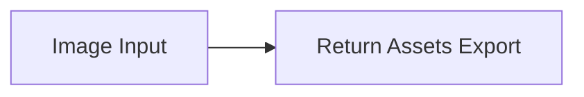

# Tutorial: Your First Workflow

This is the fastest way to *get* MOD: we'll take a photo, pass it through an
**Image Input** node into a **Return Assets Export** node, and find the result
in your Files — first by clicking through the UI, then the exact same thing
over the API.

**You'll need:** the stack from the [README quickstart](https://github.com/modtim/MOD_CORE_CE#-from-download-to-running-in-three-steps)
booted on your machine, the seeded sign-in from [Getting Started](/getting-started),
and any photo with a clear subject (`.png` or `.jpg`). Total time: ~5 minutes.

The two nodes we use below, **Image Input** and **Return Assets Export**, are
on the canvas palette of a fresh Community Edition install. Once the walk works,
add processing nodes between them — see the [Node Library](/node-library).

---

## Part 1 — Do it in the UI

### Step 1. Upload your photo

1. In the Dashboard sidebar, click **The Cellar - Files** (the page title reads *Data*).
2. Click **Upload** and pick your photo.
3. It appears in your file list.

*(Screenshot: the Data page with one uploaded image in the grid.)*

### Step 2. Build the workflow

1. Click **The Road - Orchestration** in the sidebar to open the Workflow Builder
   (or open `http://localhost:3001` directly).
2. The node palette on the left is grouped in collapsed categories. Click **Input**,
   then drag an **Image Input** node onto the canvas.
3. Click **Export**, then drag a **Return Assets Export** node onto the canvas.
4. Connect *Image Input* → *Return Assets Export*: drag from the output port of
   the first node to the input port of the second.

Your canvas should look like this:



> The builder validates connections as you draw them — an incompatible pairing
> shows a warning instead of connecting.

### Step 3. Pick your file and run

1. Click the **Image Input** node, click **Choose Files**, open **My Files** in the
   *Select Files* dialog, click your photo and click **Select**.
2. Click **Save** in the toolbar and enter a **Name** (e.g. *"First workflow"*) in the
   *Save As New Workflow* dialog. If a second dialog with **Save as-is** appears, click it.
3. Click **Execute**.

The nodes on the canvas do not change colour while the run goes. Open
**Functions > The Crossroads - Process Queue** (or read the log panel) to follow the run;
its row reads `completed` when done.

### Step 4. Get your result

When the run row reads `completed`, open **The Cellar - Files** in the sidebar and look in
**Home**: the run wrote its result files to a folder named
`<input>_results_run<N>`, where `<input>` is your photo's file name including its extension (for example
`photo.png_results_run1`) and `<N>` is the run number. Your photo is in there, passed through unchanged.

That's a complete pipeline: **input → process → output**. Everything else in
MOD is more nodes on that same canvas.

---

## Part 2 — Do the exact same thing with the API

Once you've saved the workflow above, you can run it headless. Grab two things
first:

- An **API key** — Dashboard → **Settings → API Keys → Create API Key** (it starts with
  `sk_`, shown once).
- The **workflow version id** — it's in the Workflow Builder URL once you open
  your saved workflow.

```bash
BASE=http://localhost:8000/v1

# 0. Exchange your sk_ key for a ~1h Bearer token
TOKEN=$(curl -s -X POST "$BASE/api-keys/token" -H "Content-Type: application/json" \
  -d '{"api_key": "sk_your_key_here"}' | jq -r .access_token)
AUTH="Authorization: Bearer $TOKEN"

# 1. Upload the photo -> note the returned "cog_id" (the number the run takes)
COG=$(curl -s -X POST "$BASE/files/upload" -H "$AUTH" \
  -F "file=@./product.jpg" | jq -r .cog_id)

# 2. Run your saved workflow version against it (use YOUR version id)
RUN=$(curl -s -X POST "$BASE/road/workflow-versions/<your_version_id>/run" -H "$AUTH" \
  -H "Content-Type: application/json" \
  -d "{\"cog_ids\": [$COG]}" | jq -r .workflow_run_id)

# 3. Poll until it reaches a terminal status
while :; do
  STATUS=$(curl -s "$BASE/road/workflow-runs/$RUN" -H "$AUTH" | jq -r .status)
  echo "$STATUS"
  case "$STATUS" in completed|failed|success|failure) break;; esac
  sleep 3
done

# 4. Output files are listed under run_files; download one by its file id.
#    They are the same files you see in Files > Home/<input>_results_run<N>.
FILE_ID=$(curl -s "$BASE/road/workflow-runs/$RUN" -H "$AUTH" | jq -r '.run_files[0].file_id')
curl -s "$BASE/files/$FILE_ID/content" -H "$AUTH" -o first-workflow-result.png
```

Prefer Python or JavaScript? The same loop is in
[Getting Started → Quickstart with the API](/getting-started#quickstart-with-the-api),
and you can run any of these interactively in the
[Swagger explorer](http://localhost:8000/docs).

---

## What you just learned

- **Files are cogs**, and every workflow starts from an **input node** pointing
  at one.
- A **workflow** is just nodes wired on a canvas; you **save versions** of it and
  **run** a version.
- A **run** moves through `queued → running` and ends as `completed` (or `failed`; `success` and `failure` are also accepted as terminal), and outputs are
  downloadable cogs.
- Anything you do in the UI is available over the **API** with the same building
  blocks.

## Where to go next

- Add a processing node between the two — see the [Node Library](/node-library)
  for the nodes that ship in the Community Edition.
- Process a whole folder at once with **Batch processing** — see the
  [Workflow Builder Guide](/workflow-builder).
- Run it automatically on a **schedule or event** — see Triggers in the
  [Features Catalog](/features#triggers).
