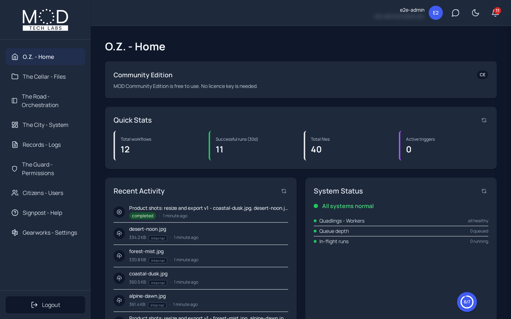
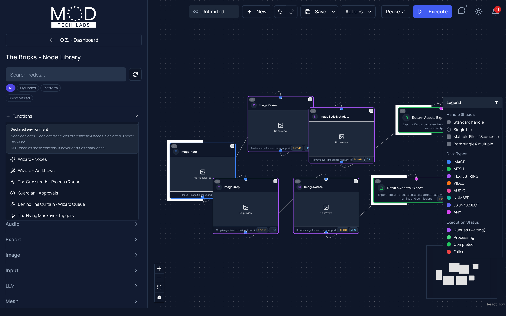
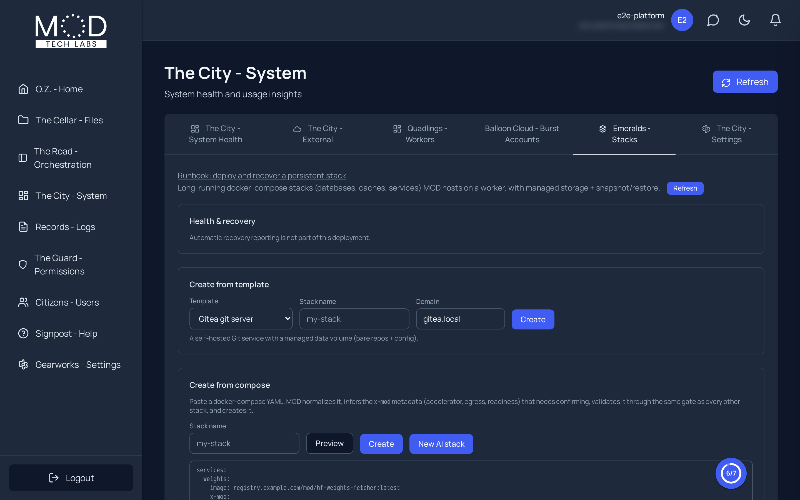
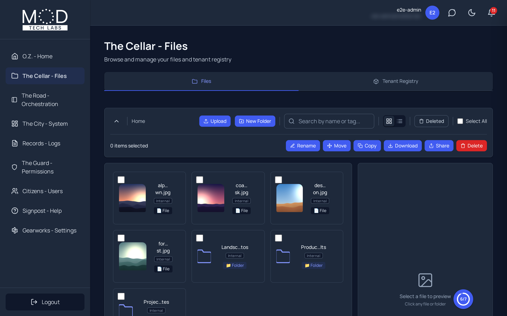
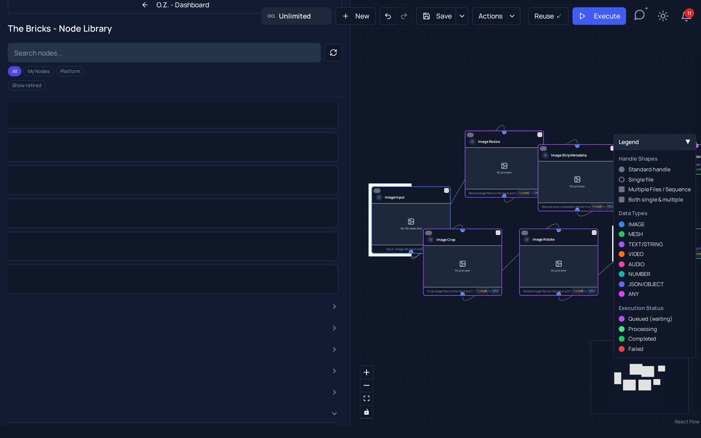
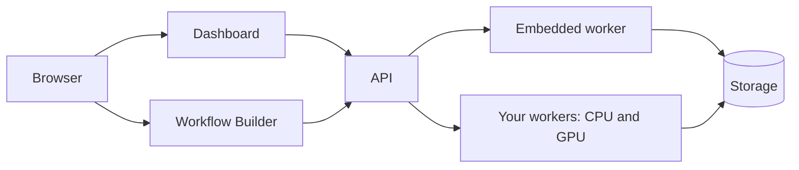

<!-- GENERATED from README.md.tmpl by open-core/render_presentation.py: edit the template or docs/assets/presentation.config.yaml, then re-render. -->
<div align="center">


# MOD Core CE

### Every Machine You Own, Working As One.

MOD Core CE is the free, open source edition of MOD Core. Build workflows and run them on your own hardware, on your CPUs by default.

[](./LICENSE)
[](https://github.com/modtim/MOD_CORE_CE)
[](#-architecture-at-a-glance)
[](#-from-download-to-running-in-three-steps)

**[Get started](#-from-download-to-running-in-three-steps)** &nbsp;|&nbsp; **[Docs](#-documentation)** &nbsp;|&nbsp; **[Community](#-built-in-the-open-better-with-you)**

<sub>On this page: [What you get](#-workflows-security-and-every-processor-you-own) · [Meet OZ](#-oz-is-made-of-zones-each-one-has-a-plain-job) · [Screens](#-see-it) · [Architecture](#-architecture-at-a-glance)</sub>

<sub>Open Source · Brought To You By MOD</sub>

</div>

---

> **The "Oz" Release.** Every zone has a name, every machine has a job, and your data lives on machines you own.

MOD Core CE is the free, open source edition of MOD Core. It makes the computers
you already own work as one. Build workflows on a visual canvas, run them on your
own hardware, and start on your CPUs. Free and Apache 2.0 licensed: no trial
clock, no license fee, and no seat, worker, concurrent-run or storage limits from
the product's own licensing (ordinary API rate limits and a 1 TiB workflow
checkpoint quota still apply). MOD sends no telemetry.

**Status:** v1.0.1 is a bug-fix release of the first public release (v1.0.0). It is maintained by Mod Tech Labs
on a best-effort basis: community support through Discussions and Issues, no SLA.
**Good fit:** a lab, studio or team with a few Linux machines. **Not for you if**
you need managed hosting or several organizations in one install (see
[Community Edition scope](./docs/community-vs-paid.md)).

**Why not just...** Docker Compose runs services; MOD adds the visual workflow
canvas, scheduling, worker placement and a run history on top. Kubernetes runs
containers at cluster scale; MOD installs with one script on a few machines and
needs no cluster. A general workflow engine (n8n, Airflow) connects web services
or schedules data jobs; MOD is built for file, media and AI pipelines on mixed hardware.

---

## 🚀 From Download To Running In Three Steps

<details>
<summary><b>Requirements</b> (Linux x86_64, Docker with Compose v2, 8 GB RAM recommended, 20 GiB disk)</summary>

| Need | What |
|---|---|
| **OS** | Linux is the supported platform. macOS and Windows (WSL2) through Docker Desktop are untested |
| **CPU** | x86_64 (amd64) is the tested architecture; arm64 is untested |
| **Docker** | Docker Engine with the **Compose v2** plugin (`docker compose version`), run as a normal user in the `docker` group |
| **RAM** | **8 GB or more** recommended (not enforced and not benchmarked; installs were tested on large hosts) |
| **Disk** | about **20 GiB** free (the images alone take about 9 GB) |
| **Network and time** | The first start downloads about 9 GB of images. A first run usually takes 10-20 minutes (pull and first start together), longer on a slow connection |
| **sudo** | On a first install the installer may stop and print one `sudo bash ...` line for the encrypted-storage folders |

Details are in the [install guide](./docs/install-guide.md).

</details>

### Download

```bash
git clone https://github.com/modtim/MOD_CORE_CE.git
cd MOD_CORE_CE
```

### Run The Installer

```bash
./scripts/install.sh --yes
```

The installer creates every password for you, downloads the images, starts MOD and
prints where to go. **On a first install it may stop with exit code 1** and print one
line of the shape `sudo bash /path/to/MOD_CORE_CE/scripts/first-run-sidecar.sh`
(it creates the root-owned encrypted-storage folders). Run that line, then run
`./scripts/install.sh --yes` again; it is safe to repeat and keeps your passwords.
If the first start is slow, `docker compose logs -f` shows progress; do not re-run
the installer while it works. Then open:

| What | Where |
|---|---|
| **Dashboard** | http://localhost:3000 |
| **Workflow Builder** | http://localhost:3001 |
| **Docs** | http://localhost:3002 |

> [!TIP]
> Add `--no-lan` to keep MOD on this computer only. Without it (including with `--yes`) the installer opens MOD to other computers on your network and tells you so.

**First login.** Open the Dashboard (port 3000). It first shows a signed-out page with a **Sign In**
button; click it and sign in as `admin@core.local`. The sign-in has two steps: type the email and
click Continue, then type the password. The password was
generated on your machine and lives in the `.env` file in the install folder:

```bash
grep '^KEYCLOAK_REALM_ADMIN_PASSWORD=' .env
```

### Run Your Workflows

1. Open the **Workflow Builder** (port 3001; from the Dashboard it is **The Road - Orchestration** in the sidebar) and start a new workflow.
2. Drag two nodes onto the canvas: **Image Input** and **Return Assets Export**. The node palette is grouped in collapsed categories: click **Input** to find Image Input and **Export** to find Return Assets Export.
3. Connect them: drag from the output of Image Input to the input of Return Assets Export.
4. Click **Image Input**, click **Choose Files**, open **My Files** in the *Select Files* dialog, click the photo you uploaded, then click **Select**.
5. Click **Save** in the toolbar and type a **Name** in the *Save As New Workflow* dialog. If a second dialog with **Save as-is** appears, click it. Then click **Execute** in the toolbar.
6. Nodes do not change colour while the run goes. Follow it in **The Crossroads - Process Queue** (under **Functions** in the Workflow Builder) or in the log panel; the run is done when its row reads `completed`. Then open **The Cellar - Files** in the sidebar and find your image in
   `Home/<input>_results_run<N>`, where `<input>` is your photo's file name including its extension (for example `photo.png_results_run1`). If the run reads `failed`, open the run and read its log;
   common fixes are in [troubleshooting](./docs/troubleshooting.md).

> [!NOTE]
> That is the whole idea: input, then output. Everything else in MOD is more nodes
placed between them on the same canvas. A longer walk-through is in the
[first workflow guide](./CORE/docs-site/docs/first-workflow.md).

---

## ✨ Workflows, Security, And Every Processor You Own

<table>
  <tr>
    <td width="33%" valign="top"><b>WORKFLOWS</b><br><br>
<b>Visual workflow builder.</b> Design workflows on a canvas and put them on a schedule.<br><br>
<b>Node builder.</b> Describe a node and the wizard builds it, or write one with the SDK.<br><br>
<b>Callable by agentic tools.</b> Your workflows are exposed as MCP tools.</td>
    <td width="33%" valign="top"><b>SECURITY</b><br><br>
<b>Your data stays home.</b> Self-hosted, with Keycloak sign-in, generated secrets and your own audit log. MOD sends no telemetry; traffic leaves your network only to services you turn on (an external LLM, model downloads, email, the node wizard's GitHub and PyPI lookups). Set `egress.sealed_mode` to block them.<br><br>
<b>Bring your own storage.</b> Built-in object store, or point MOD at your own S3.<br><br>
<b>Bring your own LLM.</b> Use any OpenAI-compatible or Ollama endpoint for the assistant and the node builder.</td>
    <td width="33%" valign="top"><b>COMPUTE</b><br><br>
<b>Run on your own machines.</b> Workers pull jobs and run containerized nodes on hardware you own.<br><br>
<b>CPU first, GPU in preview.</b> Nodes run on CPU out of the box. GPU workers are not yet proven end to end in v1.0.1 (see [GPU](./docs/operations.md#gpu)).<br><br>
<b>Burst to your own cloud (preview).</b> Optionally send jobs to your own cloud account with your own credentials; nothing comes from MOD.<br><br>
<b>Stacks.</b> Run models on your own hardware and use them from your workflows.</td>
  </tr>
</table>

---

## 🧙 OZ Is Made Of Zones. Each One Has A Plain Job.

The product is called **OZ**, short for Orchestration Zone: the whole system in
one place. Each zone has an Oz name and a plain job, and the Oz names are the names you see in the product. The internal identifiers
(routes, environment variables, compose names) do not change.

| Zone | Oz name | Its plain job |
|---|---|---|
| Orchestration Zone | **OZ** | The whole system: every zone in one place |
| Workflows | **Toto** | Build and run node graphs |
| Orchestration | **The Road** | Runs move work across zones |
| Workers | **Quadlings** | Run jobs on your machines |
| Stacks | **Emeralds** | Run models on your hardware |
| Node Builder | **Tinker** | Build nodes from nothing |
| Help and assistant | **Glinda** | Chat that takes you places and explains a failed run |
| Manager | **Ozma** | Manage zones and loans |
| RAG | **Cyclone** | Feed documents to your assistant (not in the starting node list yet) |
| Triggers | **Monkeys** | Fire on events and schedules |

The full list lives in the [product names](./CORE/docs-site/docs/product-names.md) page.

---

## 🖼 See it

<table align="center">
  <tr>
    <td align="center"><br><sub>The City (Dashboard): runs and workers at a glance</sub></td>
    <td align="center"><br><sub>Toto (Workflows): the visual workflow builder</sub></td>
  </tr>
  <tr>
    <td align="center"><br><sub>Emeralds (Stacks): run models and services on your hardware</sub></td>
    <td align="center"><br><sub>The Cellar (Files): inputs and run results</sub></td>
  </tr>
  <tr>
    <td colspan="2" align="center"><br><sub>The Bricks (Node Library): every node in one place, ready on day one</sub></td>
  </tr>
</table>

---

## 🏗 Architecture at a glance



Everything runs on machines you own. The API schedules each job onto a matching
worker; the embedded worker runs from day one and you add more machines when you
want them. Your workers talk to your install over your own network, and MOD sends no
telemetry. More in the [architecture page](./docs/architecture.md).

**GPUs.** CE v1 runs nodes on CPU out of the box; GPU workers are a preview
(see [GPU in the operations guide](./docs/operations.md#gpu)).

---

## 📚 Documentation

- [Install guide](./docs/install-guide.md): prerequisites, the full quickstart, images and resets.
- [Operating MOD Core CE](./docs/operations.md): secrets, adding people, access from other computers, GPUs, upgrades.
- [Troubleshooting](./docs/troubleshooting.md): the fixes first installs need most.
- [Backup and restore](./CORE/docs-site/docs/runbooks/ce-backup-and-restore.md), plus `scripts/ce-resize.sh` and `scripts/recover-after-reboot.sh` (usage headers inside) for resizing and recovery after a reboot.
- After a reboot, the core comes back by itself in about 3 minutes. Docker does not start your stacks. Once the worker is up, it starts them one at a time, about 10 seconds apart: lowest stack number first, and stacks that use a GPU last. It writes each stack's secret files before starting it, and it leaves stopped stacks stopped. If a stack crashes, the worker restarts it the same way, waiting longer between tries (up to 5 minutes). Nothing extra is needed on WSL. To let Docker restart stacks instead, set `MOD_STACK_WORKER_START=0` in `.env`.
- Run only one CE install per host. A second install on a host that already runs one fails, because both want the same container names and ports.
- [Node builder](./docs/node-builder.md) and [authoring nodes](./docs/authoring-nodes.md).
- [Community Edition scope](./docs/community-vs-paid.md), [release notes](./RELEASE-NOTES.md) and [changelog](./CHANGELOG.md).

---

## 💖 Built In The Open. Better With You.

Come build it with us. Ask a question, share an idea, report a bug or send a fix.

- **Discussions:** https://github.com/modtim/MOD_CORE_CE/discussions
- **Issues and feature requests:** [GitHub Issues](https://github.com/modtim/MOD_CORE_CE/issues)
- **Contributing:** [CONTRIBUTING.md](./CONTRIBUTING.md) (DCO sign-off, no CLA)
- **Governance:** [GOVERNANCE.md](./GOVERNANCE.md) and [Code of Conduct](./CODE_OF_CONDUCT.md)
- **Security:** [SECURITY.md](./SECURITY.md), email `admin@modtechlabs.com`; please do not file vulnerabilities in the public tracker.
- **Trademark:** "MOD", "MOD Core" and the MOD logos are marks of Mod Tech Labs Inc. and are not covered by the Apache license; see [TRADEMARK.md](./TRADEMARK.md).

<div align="center">

---

<picture>
  <source media="(prefers-color-scheme: dark)" srcset="docs/assets/logo/dotted-o-dark.svg">
  
</picture>

Apache 2.0 licensed ([LICENSE](./LICENSE), [NOTICE](./NOTICE)); third-party components keep their own licenses.<br>
Brought to you by **[MOD Tech Labs](https://modtechlabs.com/)**

</div>
