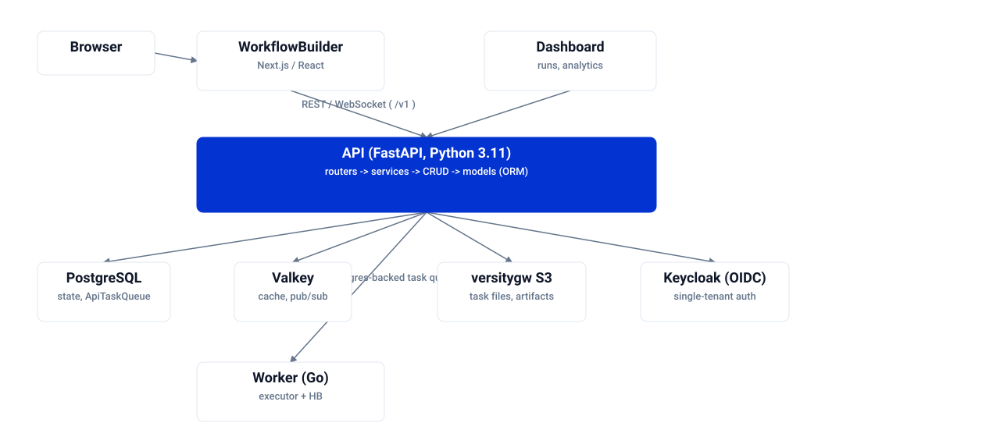

# Architecture and what is included

How the pieces fit, how storage is encrypted and what ships in Community Edition. [Back to the README](../README.md).

## Encrypted storage (gocryptfs inside each store)

User files (versitygw object store) and the Valkey cache are encrypted at rest by
gocryptfs mounted **inside their own container**: the CE images `versitygw-enc` and
`valkey-enc` (build contexts under `CORE/DockerContainers/encrypted-store/`, one shared
`entrypoint-enc.sh`) mount the view at `/data` over the host ciphertext dir the compose
binds at `/ciphertext-raw`. Nothing is shared between containers and no plaintext dir
exists on the host at all, so this works on native Linux **and** on Docker Desktop /
WSL2, where a shared-mount pattern cannot work.

- **Ciphertext lives here:** `${VERSITYGW_CIPHER_PATH:-/var/lib/mod/versitygw-ciphertext}/<tenant slug>`
  (the slug comes from `CE_TENANT_SLUG`, default `t1`) and
  `${VALKEY_CIPHER_PATH:-/var/lib/mod/valkey-ciphertext}/data` (fixed `data` leaf, no slug).
  Both hold only encrypted bytes — on disk you never see the plain files.
- **Back up:** the ciphertext dirs **and** the passphrase file
  (the persistent passphrase file `/var/lib/mod/gocryptfs-pass`, `0600`, root-owned, next to
  the ciphertext dirs; the stores mount this exact file read-only at `/run/secrets/gocryptfs-pass`
  inside their containers; a host `/run/secrets` copy, which a reboot wipes, is rebuilt from it
  by `scripts/first-run-sidecar.sh` / `scripts/recover-after-reboot.sh`) **together**, plus the
  `gocryptfs.conf` inside each ciphertext dir. Losing the passphrase loses the data:
  ciphertext cannot be recovered without it. If the ciphertext exists but the key file is
  missing, the script stops and asks you to restore the file from your backup; it never
  makes a new key over existing data. Losing `gocryptfs.conf` means that store
  never starts and its data is unrecoverable (fail-closed).
- **Created for you:** `scripts/first-run-secrets.sh` (it calls the host-side storage
  helper in the same `scripts/` tree) creates the two host ciphertext dirs and generates
  the passphrase file ONCE at `0600`.
  It never prints the passphrase, never puts it in `.env`, and never runs `gocryptfs -init`
  (the image entrypoint does that, once, over a virgin dir only — over existing ciphertext
  it refuses, because re-init would destroy the store). On a non-root shell it prints the
  one `sudo` line to run.
  If you already ran that `sudo` line and run the script again as yourself, it now
  says plainly that it cannot read the root-owned key files and asks you to
  run the same `sudo` line again; it does not claim the passphrases differ, and it
  changes nothing. The `sudo` step is the one to repeat; everything else stays as it is.
- **Host:** Linux offering `/dev/fuse`. The two stores run with `cap_add: SYS_ADMIN` and
  `apparmor:unconfined` for the mount, then drop `SYS_ADMIN` before the store process
  starts. Native Linux and Docker Desktop / WSL2 both work. See
  `CORE/DockerContainers/encrypted-store/README.md` (ships in this repo) for the image
  pins, the privilege model and the recovery path.

## Architecture overview

<p align="center">
  <picture>
    
  </picture>
</p>

<details>
<summary>Plain-text diagram</summary>

```
                +-------------------+        +-------------------+
   Browser ---> | WorkflowBuilder   |        | Dashboard         |
                | (Next.js / React) |        | (runs, analytics) |
                +---------+---------+        +---------+---------+
                          |   REST / WebSocket ( /v1 ) |
                          v                            v
                +--------------------------------------------------+
                |            API  (FastAPI, Python 3.11)           |
                |  routers -> services -> CRUD -> models (ORM)     |
                |  orchestrator | scheduler | node scanner | auth  |
                +----+----------------+---------------+------------+
                     |                |               |
        PostgreSQL <-+   Valkey       |   versitygw S3|   Keycloak (OIDC)
        (state,          (cache,       (task files,     (single-tenant
         ApiTaskQueue)    pub/sub)      artifacts)       auth)
                     |
                     |  ApiTaskQueue (Postgres-backed task queue)
                     v
                +-------------------+
                | Worker (Go)       |  pulls tasks, runs containerized
                | executor + HB     |  nodes, reports results
                +-------------------+
```

</details>

- **State** lives in PostgreSQL (`WorkflowRun`, `NodeRun`, `ApiTaskQueue`).
- **Tasks** are dispatched to the Go worker via the Postgres-backed
  `ApiTaskQueue` table; the worker executes each **node** as a container.
- **Nodes** are Docker images plus a metadata definition (inputs/outputs,
  category, container image). Core ships a "batteries-included" starter pack;
  you author more by hand or with the SDK.
- **Caching / pub-sub** uses Valkey (OSI-licensed). Basic RAG nodes are not in the
  CE node seed list (27 keep-listed nodes plus the 9 system build nodes, none of them RAG) — see "What's included" below and
  [docs/community-vs-paid.md](./community-vs-paid.md).

## What's included (Community Edition)

A **runnable, batteries-included** starting point:

- The workflow **engine + DAG execution**, the **Go worker**, the
  **WorkflowBuilder**, and the **Dashboard**.
- Single-tenant auth.
- A **local / BYO-LLM node wizard** (point it at any OpenAI-compatible or
  Ollama endpoint) that builds nodes with the published `build-task` /
  `containerizer` images — built nodes stay on the machine that built them, with
  an optional `registry` compose profile for more than one worker (see
  [docs/node-builder.md](./node-builder.md)) — plus hand/SDK node
  authoring.
- Basic on-demand model/stack lifecycle.
- A free node pack: the node types in CORE/API/services/node-seed-keeplist.yaml (all inputs incl. Image/Text/Audio/Video/Mesh/Resource/Script Input; Return Assets Export; the converters; Human Approval; Text LLM; Stack Model Call; FFmpeg (CPU); the image ops; system-web-search) — plus the `*_INPUT_Node.py` /
  `*_EXPORT_Node.py` SDK authoring examples. Basic audio and basic RAG are
  **not seeded in CE today**: basic audio-processing nodes (beyond Audio
  Input / Audio Converter) and basic RAG are not included in Community
  Edition today.
  See [docs/community-vs-paid.md](./community-vs-paid.md) for the full
  SHIPS / NOT IN CE breakdown.

Core runs single-tenant, free, and unlimited.
